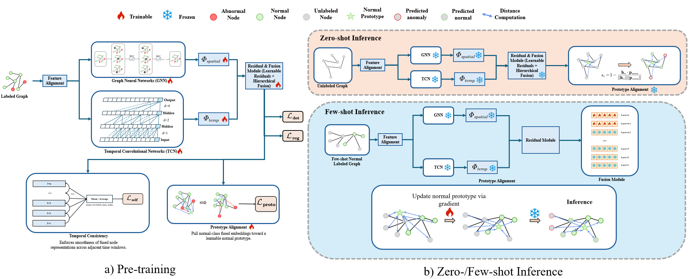

# SPAD: Single-Prototype Adaptation for Dynamic Graph Anomaly Detection

> The executable, repaired experiment instructions are in [RUNNING.md](RUNNING.md). The pipeline now defaults to a strict single normal prototype; `--prototype_mode dual` is reserved for the ablation.

## Overview

SPAD is a framework for zero-shot and few-shot anomalous-node detection in dynamic graphs. It combines normal-population alignment with temporal consistency learned from source-domain dynamic graphs.



## Key Features

- **Zero-Shot Anomaly Detection**: Can detect anomaly nodes in dynamic graphs without any labeled samples from the target domain
- **Few-Shot Fine-tuning**: Supports rapid adaptation to target domains through sparse annotations
- **Temporal Modeling**: Explicitly captures temporal dependencies and structural evolution patterns
- **Dual-Alignment Mechanism**: Combines self-evolution inconsistency modeling with population-level alignment
- **Directional Prototype-Transport Residual**: Scores nodes that fail to follow the label-free source-to-target normal-population shift

## Method Introduction

SPAD is developed based on two core principles:

1. **Self-Evolution Inconsistency**: Anomaly nodes' evolution directions are inconsistent with their historical self-evolution trajectories
2. **Global Evolution Inconsistency**: Anomaly nodes are inconsistent with overall population evolution trends

The framework explicitly models these principles through:
- **Temporal Consistency Constraints**: Captures self-evolution inconsistency
- **Single-Prototype Population Alignment**: Characterizes global evolution inconsistency
- **Robust Target Prototype Transport**: Estimates the target normal centre from informative, temporally stable majority nodes
- **Directional Transport Residual**: Uses `d_target - d_source` as the zero-shot anomaly ranking score, without target labels or a target-fitted mixing weight

This approach learns transferable discriminative priors under source domain supervision, enabling effective zero-shot transfer to target domains.

## Performance

| Setting | AUC | AP |
|---------|-----|-----|
| Zero-Shot engineering check (DGraphFin → FiGraph, seed 42) | 0.7654 | 0.0843 |

*Verified end-to-end from the final inference path using a 50-epoch seed-42
run. Report multi-seed mean and standard deviation in the paper after
the complete experiment launcher finishes; the old unverified 0.9537/0.0180
placeholder has been removed.*

## Project Structure

```
ProtoDGAD/
├── anomaly_gfm_complete_model.py    # SPAD temporal graph model
├── data_processor.py                # Data loading and preprocessing
├── few_shot_finetune.py            # Few-shot fine-tuning implementation
├── model_adapter.py                # Sparse graph model adapter
├── sparse_graph_utils.py           # Sparse graph processing utilities
├── train_anomaly_gfm.py            # Main training script (zero-shot)
├── utils.py                        # Utility functions
├── plot_results.py                 # CSV aggregation and paper figures
├── run_experiments.ps1             # Reproducible experiment launcher
├── results/                        # Raw and aggregated CSV results
└── outputs/                        # Checkpoints and fitted feature aligners
```

## Installation

### Requirements

- Python 3.8+
- PyTorch 1.10+
- PyTorch Geometric 2.0+
- SciPy
- NumPy
- scikit-learn

### Setup

```bash
# From the ProtoDGAD directory, after installing a CUDA-compatible PyTorch build
pip install -r requirements.txt
python smoke_test.py
```

## Datasets

### Source Domain: DGraphFin

DGraphFin is a financial transaction dataset containing temporal graph data with anomaly labels. It contains:
- Multiple temporal snapshots
- Node features (17 dimensions)
- Binary anomaly labels

### Target Domain: FiGraph

FiGraph is another financial dataset with different feature dimensions (772 dimensions) used for zero-shot evaluation. Feature alignment is applied to enable cross-domain transfer.

## Usage

### Zero-Shot Detection

Run zero-shot anomaly detection from DGraphFin (source) to FiGraph (target):

```bash
python train_anomaly_gfm.py --mode dynamic --start_year 2018 --end_year 2022 --epochs 50 --batch_size 1 --seed 42 --method_version dipt --run_name spad_dipt_full_seed42
```

**Parameters:**
- `--mode`: Graph mode (use "dynamic")
- `--start_year`: Starting year for training data
- `--end_year`: Ending year for training data
- `--epochs`: Number of training epochs

### Few-Shot Fine-tuning

Fine-tune the pre-trained model on target domain with sparse annotations:

```bash
python few_shot_finetune.py --model_path outputs/spad_full_seed42/checkpoints/best_source_loss.pth --seed 42
```

This script will:
1. Load the pre-trained checkpoint from zero-shot training
2. Build a support set with a small number of labeled nodes
3. Fine-tune the model for rapid target domain adaptation

## Key Components

### Model Architecture

The `AnomalyGFMModel` implements:
- **TemporalConvNet**: Temporal convolution for sequence processing
- **GraphNeuralNetwork**: Graph structure encoding with residual connections
- **HierarchicalFusionNetwork**: Multi-level feature fusion
- **Dual Alignment**: Temporal consistency and single-normal-prototype alignment

### Feature Alignment

To enable cross-domain transfer between DGraphFin (17-dim) and FiGraph (772-dim), the framework implements:
- **SVD-based alignment**: Projects features to a common space
- **Linear projection**: Learns domain-invariant representations

### Loss Functions

- **Prototype Contrastive Loss**: Learns discriminative prototypes
- **Temporal Consistency Loss**: Ensures smooth temporal evolution
- **Residual Regularization**: Promotes representation diversity

## Main Contributions

1. **Unified Framework**: First unified framework for zero-shot/few-shot anomaly detection in dynamic graphs

2. **Dual-Alignment Design**: Novel temporal graph representation learning with dual-alignment constraints
   - Temporal consistency constraints
   - Single-prototype population alignment

3. **Theoretical Foundation**: Strong theoretical support with proof of effectiveness

4. **Practical Applicability**: Efficient and practical technical pathway for industrial-level dynamic graph anomaly detection

## Citation

If you use this code or method in your research, please cite our paper once published:

*To be updated after paper publication.*

## License

This project is licensed under the MIT License.

## Contact

For questions or issues, please open an issue on GitHub or contact the authors.

